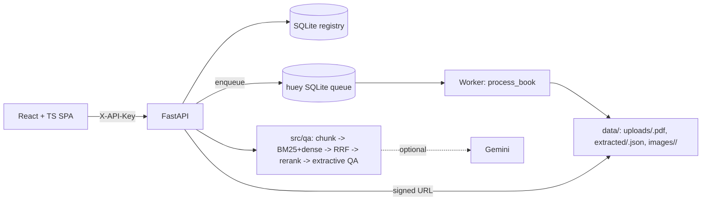

# Production Hardening Plan

Branch: `production-hardening` (from `main` @ `ecab306`).
Your uncommitted frontend edits are preserved on `wip/frontend-local-edits` (commit `08c5f4a`).
Live progress: [docs/PA-OH-1.md](docs/PA-OH-1.md) (regenerated every 10 s by `scripts/dev/progress_board.py`).

## Starting point (audit, 2026-11-07)

| Area | Score | Main problems |
| --- | --- | --- |
| QA quality (offline) | 3 | Fragment answers, question echo, off-topic marked sufficient, chemistry-only prompt |
| API robustness / security | 3 | Public `/media` of all data, no limits, sync processing, memory-only registry |
| PDF extraction (digital) | 7.5 | Captions sometimes bullets/body text, caption text in filenames |
| Scanned / OCR | 5.5 | PaddleOCR not installed, falls back to Tesseract, captions = nearby paragraphs |
| Frontend | 4 | Single 134-line file, 1,571-char lines, 550 KB bundle |
| Deployment | n/a | Training libs in API image, Florence weights not shipped |
| Code quality / tests | 5 | 574 ruff issues, 38 broad excepts, no API tests |

## Environment constraints found

- **No Docker, Redis or Ollama on this machine.** Docker images cannot be built or measured here; the Dockerfiles and
  compose file will be written and statically checked, and CI builds them. No Redis, so background jobs use **huey
  with SQLite storage** (no extra service). No Ollama, so the optional local-LLM path is not implemented by default.
- **`model/florence_layout/` is empty (0 bytes).** There are no fine-tuned Florence weights on disk, so they cannot be
  pushed to the Hugging Face Hub or loaded. `/readyz` will report this honestly (see Phase 5).
- **No GPU access.** Everything is sized for CPU.

## Target architecture



## API contract (v2): the frontend builds against this

All endpoints under `/api` need `X-API-Key: <key>` (or `Authorization: Bearer <jwt>` when `AUTH_MODE=jwt`).
`AUTH_MODE=none` is for local dev only. Errors always look like:
`{"error": {"code": "BOOK_NOT_FOUND", "message": "...", "request_id": "..."}}`.

| Method | Path | Response |
| --- | --- | --- |
| POST | `/api/books` (multipart `file`) | `202 {book_id, job_id, status}`; `413` too large, `415` not a PDF, `422` too many pages |
| GET | `/api/jobs/{job_id}` | `{job_id, book_id, status: queued\|running\|succeeded\|failed, progress: 0..1, message, error}` |
| GET | `/api/books` | `{books: [BookSummary]}` for the caller only |
| GET | `/api/books/{book_id}` | `BookDetail` (404 if not owner) |
| POST | `/api/books/{book_id}/questions` `{question}` | `Answer` |
| GET | `/api/books/{book_id}/figures/{figure_key}/image?exp=&sig=` | PNG (signed, short-lived URL) |
| GET | `/api/books/{book_id}/file?exp=&sig=` | PDF (signed) |
| GET | `/healthz`, `/readyz`, `/metrics` | liveness, readiness (models, DB, queue), Prometheus |

```text
BookSummary = {book_id, filename, status, total_pages, created_at}
BookDetail  = BookSummary + {digital_pages, scanned_pages, pages: [Page]}
Page        = {page_number, page_type: "Digital"|"Scanned", status: ok|degraded|failed, text, word_count,
               errors: [{code, message}], figures: [Figure]}
Figure      = {figure_key, figure_id, label, caption: string|null, page_number, image_url}
Answer      = {answer, extractive_answer: string|null, is_sufficient, confidence: 0..1, mode: "offline"|"gemini",
               citations: [{page_number, section: string|null, chunk_id, snippet, figure_ids: [string]}],
               figures: [Figure]}
```

## Phases

### Phase 1: QA quality
Files: new `src/qa/` (`chunking.py`, `retrieval.py`, `rerank.py`, `answer.py`, `gemini.py`, `engine.py`,
`models.py`); `src/qa_engine.py` becomes a thin facade (keeps the 27 existing tests' imports working);
`tests/eval/qa_golden.jsonl`, `tests/eval/qa_dev.jsonl`, `scripts/eval/run_qa_eval.py`, `Makefile`.

- Chunk normalized pages into paragraph chunks (~60-220 words) with page, section heading and figure refs.
- BM25 (`bm25s`) + dense (`BAAI/bge-small-en-v1.5`, numpy cosine, cached per book on disk), fused with RRF (k=60),
  top 20 reranked by `cross-encoder/ms-marco-MiniLM-L6-v2` (22 M params, fast on CPU; `bge-reranker-base` kept as a
  configurable option).
- Equation boost only when the question asks for an equation/reaction/formula.
- Insufficiency: calibrated reranker threshold + `deepset/roberta-base-squad2` null score (+ Gemini self-check when on).
  Thresholds are tuned on `qa_dev.jsonl` and reported on the separate `qa_golden.jsonl` to avoid overfitting.
- Offline answer: extractive span + 1-3 best supporting sentences (no questions, headings, exercise prompts or echo).
- Document-agnostic prompt with the book title and cited sections injected.
- Gemini via `google-genai`: timeout, 2 retries (tenacity), fallback to offline on any API error; mocked tests.

Risks: model download size (~700 MB total) and CPU latency; threshold calibration on a small eval set.

### Phase 2: API security and robustness
Files: `api/` split into `config.py` (pydantic-settings), `db.py` (SQLModel), `auth.py`, `security.py` (signed URLs),
`jobs.py` (huey), `routes/*.py`, `errors.py`, `observability.py`, `book_cache.py`; `src/storage.py`.

- Remove the `/media` static mount; media only through ownership-checked, HMAC-signed, expiring URLs (img tags cannot
  send headers). Raw extraction JSON is never served.
- Auth: API keys (`API_KEYS`, stored as SHA-256 hashes) or JWT (`AUTH_MODE=jwt`, `JWT_SECRET`); `slowapi` limits on
  upload and ask.
- Upload: streamed to disk with `MAX_UPLOAD_MB` (default 50) enforced, `%PDF-` magic check, `MAX_PAGES` (default 1500),
  stored as `uploads/<sha256>.pdf`; original filename only in the DB, so same-name files never collide.
- Background processing with huey; `202` + `/api/jobs/{id}` with progress.
- SQLite registry (`books`, `jobs`) with indexed primary keys; LRU cache of loaded books; survives restarts.
- Request-ID middleware, structlog JSON logs, `/healthz`, `/readyz`, `prometheus-fastapi-instrumentator`.
- The per-request `api_key` body field for Gemini is removed: Gemini is configured server-side only.

Risks: SQLite write contention between API and worker (WAL mode mitigates); huey worker must share the data volume.

### Phase 3: Extraction, OCR and figures
Files: `src/ocr_engine.py`, `src/scanned_pipeline.py`, `src/digital_pipeline.py`, `src/captions.py` (new),
`src/pdf_processor.py`, `tests/fixtures/captions_labeled.json`, `tests/test_captions.py`.

- RapidOCR (ONNX, Apache-2.0) as primary OCR; PaddleOCR optional; Tesseract last fallback; `degraded` flag kept.
- Captions: only text that starts with `Fig./Figure/Table N(.N)` within a distance window above/below the figure bbox
  and in the same column; symbol-font spans (Wingdings, Symbol, ZapfDingbats, etc.) dropped by font name; otherwise
  `caption = null`.
- Filenames `images/<sha256>/p{page}_fig{n}.png`; no caption text in filenames.
- Scanned pages: caption lines found by the same regex on OCR line boxes plus image-region detection (OpenCV contour
  regions); body paragraphs never become captions.

Risks: changing captions changes figure ids used by existing tests; the labeled set is hand-labeled by me.

### Phase 4: Frontend
Files: `frontend/` rewritten in TypeScript (`src/api`, `src/components`, `src/pages`, `src/hooks`, `src/styles`),
ESLint, Prettier, Vitest + RTL, Playwright. Done in a parallel worktree against the contract above, then merged.

- TanStack Query, upload progress (XHR), job polling, error/empty states, clickable citations.
- React.lazy for the figure viewer and full-text panel; KaTeX loaded lazily (the main bundle-size cause).
- `VITE_API_URL` and dev proxy default to port 8000 everywhere.

Risks: Lighthouse cannot run headless here without Chrome; a11y checked with axe in Playwright instead if needed.

### Phase 5: Deployment
Files: `requirements/{api,worker,train,dev}.txt` (pinned), `Dockerfile.api` (multi-stage, non-root, CPU torch),
`frontend/Dockerfile`, `docker-compose.yml` (api + worker + frontend), `.env.example`, `.github/workflows/ci.yml`,
`scripts/fetch_models.py`, `railway.toml`.

- Training libs (peft, datasets, accelerate, paddle) out of the API image; CPU-only torch wheel index.
- Florence weights fetched with `huggingface_hub` from `FLORENCE_HF_REPO` (token via `HF_TOKEN`) at start, or a mounted
  volume. `FLORENCE_MODE=required|base|disabled`; with `required`, `/readyz` returns 503 when weights are missing.
- One `PORT` (default 8000) in Dockerfile, compose, Vite proxy and README.

Risks: image size cannot be measured locally (no Docker); CI will report it.

### Phase 6: Code quality and tests
- `ruff check` + `ruff format` to 0, mypy on `api/` and `src/qa/` (+ core pipeline where feasible) to 0.
- Replace every `except Exception` with specific exceptions + logging.
- httpx TestClient tests for auth, limits, job flow, media access, ask (answerable/unanswerable/Gemini mocked),
  restart persistence; coverage >= 85% on `api/` and `src/qa/`, enforced in CI.
- pre-commit (ruff, ruff-format, mypy, prettier, eslint); README rewrite.

## Library choices and licenses

| Purpose | Library | License | Note |
| --- | --- | --- | --- |
| PDF parsing | PyMuPDF (existing) | **AGPL-3.0** | **Flagged.** Network use of AGPL code may require releasing source. Permissive alternative: `pypdfium2` (Apache-2.0/BSD) for rendering + `pdfplumber` (MIT) for text/boxes. Migration is offered as a follow-up; it touches every pipeline file. |
| OCR | RapidOCR + onnxruntime | Apache-2.0 / MIT | Light, no Paddle runtime |
| OCR fallback | Tesseract / pytesseract | Apache-2.0 | |
| Sparse retrieval | bm25s | MIT | |
| Dense / rerank | sentence-transformers, bge-small-en-v1.5, ms-marco-MiniLM-L6-v2 | Apache-2.0 / MIT / Apache-2.0 | |
| Extractive QA | transformers, deepset/roberta-base-squad2 | Apache-2.0 / CC-BY-4.0 (model) | |
| API | FastAPI, SQLModel, pydantic-settings, slowapi, PyJWT | MIT | |
| Jobs | huey | MIT | SQLite backend, no Redis |
| Observability | structlog, prometheus-fastapi-instrumentator | MIT/Apache-2.0, ISC | |
| Frontend | React, TanStack Query, Vite, Vitest, Playwright | MIT / Apache-2.0 | |

## Working rules
One small commit per fix, test suite green after every commit, all versions pinned, no paid services required.
